# Architecture

This page tells you how hotmemory stores memory on Hotdata. It follows each operation from
the call of the consumer down to the engine, the catalog, and object storage. It also
draws the line between the work that hotmemory does and the work that the platform does.

The rules of each operation are in [contracts.md](../contracts.md), and their proofs are in
[guarantees.md](../guarantees.md). This page does not repeat the rules. It shows the calls,
the SQL, and the loads that carry them out.

Each claim has one of these sources:

- The code of hotmemory at commit `a0145ee`, the merge of phase 10. Such a claim has no mark.
- A measurement in [contracts.md](../contracts.md) or [guarantees.md](../guarantees.md), marked
  [measured] with its date.
- A look at the local stack on 2026-10-12, marked [observed, local].
- The source of `hotdata-framework` 0.14.1 and `hotdata` 0.11.0, the client libraries that
  hotmemory calls. Such a claim is marked [read from source, not observed].

## The two sides

hotmemory is a library. It runs inside the process of the consumer, and there is no
hotmemory server. It calls the Hotdata API through `hotdata-framework`, with the API key of
the consumer.

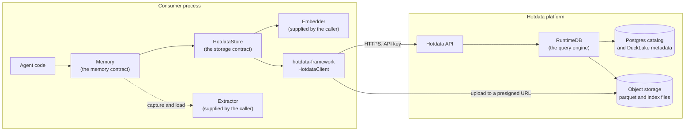

In the cloud, the API is at `api.hotdata.dev`. The source of `hotdata-framework` names a
CDN and a gateway between the client and the engine. [read from source, not observed]
Locally, the engine serves the API itself on port 3000 and accepts every request with no
token. [local.md](../local.md) describes the local stack.

### Who does what

| Concern | hotmemory | The platform |
|---|---|---|
| Record rules | Revisions, deduplication, merged sources, `close_previous`, the episode line | Nothing. A load replaces rows by key and compares no values. [measured] |
| Embeddings | Calls the embedder of the caller for each new row and each query | Nothing. hotmemory uses no provider-backed index. |
| Tenancy | Filters on the namespace labels in SQL | A database is the boundary. The API token allows a list of workspaces. [measured] |
| Concurrent writes | One lock in each store, and a retry on `409 RESOURCE_LOCKED` | Locks a table for each load, and refuses a second load with 409. [measured] |
| Expiry | Hides a record past `forget_after` in SQL, and deletes it in `sweep` | Deletes nothing. [measured] |
| Rows on disk | Builds each batch of rows as a parquet file | Stores the rows as parquet files and records them in DuckLake metadata. [observed, local] |
| Indexes | Asks for seven indexes at provision | Builds and stores them. [observed, local] |
| Queries | Writes every SQL query, with values as literals | Plans and runs the SQL. |

## Where the data lives

hotmemory keeps one schema version in one managed database. A managed database is a
database that the Hotdata API owns and fills from uploaded files. The database holds four
tables in the schema `public`. SQL names them `default.public.<table>`.

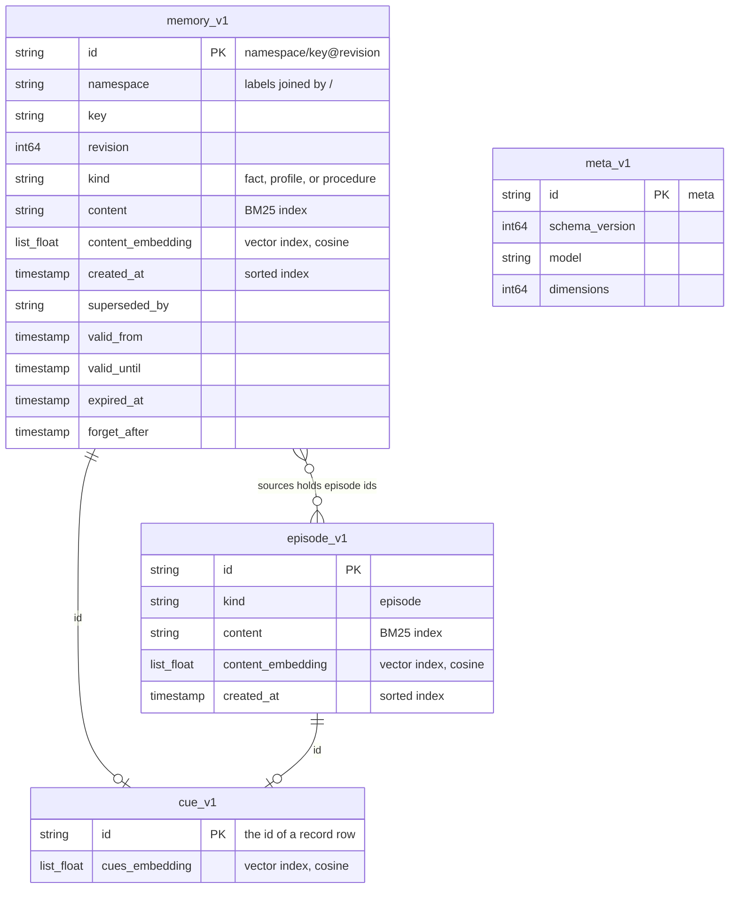

The diagram shows only the columns that this page uses. `memory_v1` and `episode_v1` have
the same 21 columns: one for each field of the record, and `content_embedding`. `cues`,
`tags`, and `sources` are lists of strings, `payload` is JSON text, and each timestamp is in
UTC to the microsecond.

| Table | Rows | Indexes |
|---|---|---|
| `memory_v1` | The records of kind `fact`, `profile`, and `procedure` | BM25 on `content`, plain cosine vector on `content_embedding`, sorted on `created_at` |
| `episode_v1` | The records of kind `episode` | The same three |
| `cue_v1` | One row for each record that has cues: its id and the vector of its cues | Plain cosine vector on `cues_embedding` |
| `meta_v1` | One row: the schema version, the embedding model name, and the vector size | None |

Every table has the key column `id`. A keyed load replaces or deletes rows by this column.
A plain vector index covers a vector column that the caller fills. hotmemory fills each
vector itself with the embedder of the caller.

On the local stack, the platform keeps the data in two places. [observed, local]

- The Postgres catalog holds the tables of RuntimeDB, for example `databases`, `uploads`,
  `jobs`, and `indexes`. It also holds the DuckLake tables, for example
  `ducklake_snapshot`, `ducklake_data_file`, and `ducklake_delete_file`. DuckLake metadata
  records which parquet files make up each version of a table.
- Object storage holds the rows of each table as parquet files under
  `ducklake_data/<catalog>/public/<table>/`. It holds the index files under
  `cache/<connection>/public/<table>/indexes/`: a `.tar.gz` file for BM25, a `.usearch` and
  a `.feather` file for a vector index, and a parquet file for a sorted index. It also
  holds query results as parquet files under `cache/_runtimedb_internal/runtimedb_results/`.

The local `memory_v1` folder held hundreds of parquet files, one table with many loads
behind it. Whether each load writes exactly one new file was not observed. Where the cloud
keeps these files was not observed.

## Provision

`HotdataStore.provision(name, embedder=..., model=..., dimensions=...)` opens the database
whose description is `name`, or creates it. `HotdataStore.open(database_id, ...)` runs
only the checks of the first branch.

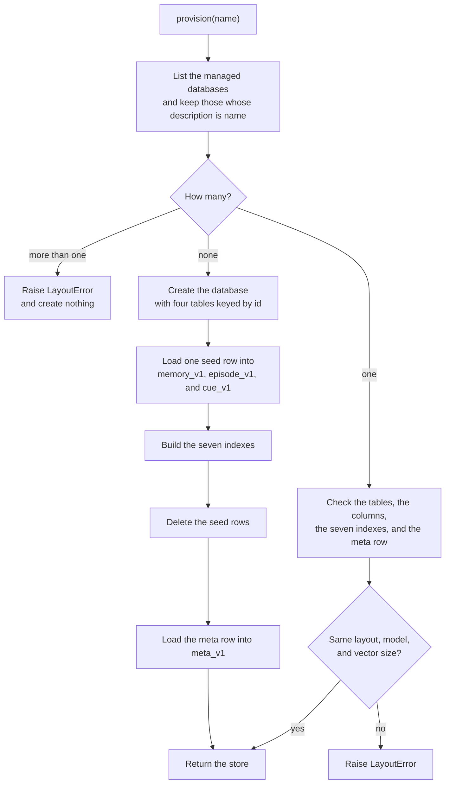

The engine refuses a BM25 index or a plain vector index on an empty table.
[measured, local, 2026-10-08] So `provision` builds the indexes over a seed row. The seed
row has the id `seed`, the content `seed`, and a vector of 1.0 in each dimension. Every
other column is null. After the indexes exist, a keyed delete load removes the seed rows.

The meta row is loaded last. A database without it did not finish provisioning, and the
next `provision` or `open` raises `LayoutError` for it.

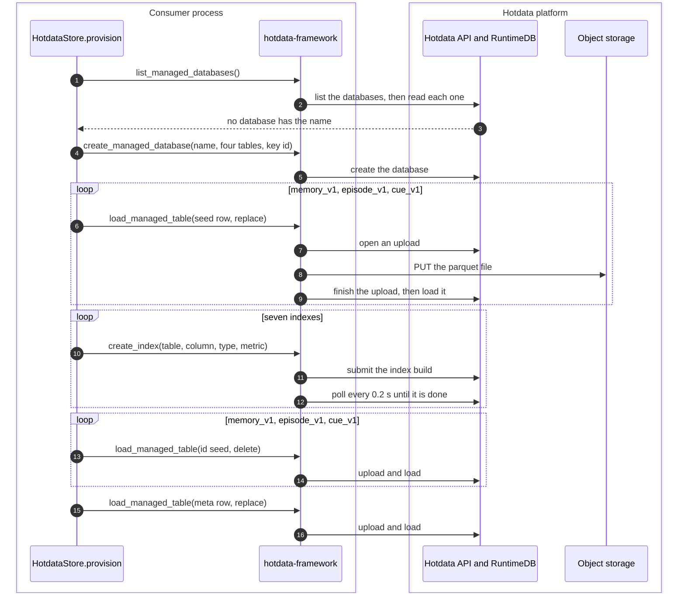

The upload steps come from the source of the `hotdata` SDK: open an upload session, send
the file to storage, and finish the session. [read from source, not observed] The upload to
a presigned URL was measured on the local stack on 2026-10-05.

The check of an existing database reads the column names of each table. It lists the
indexes of the three tables that have them, and it reads the meta row with SQL. The model
name and the vector size must equal the arguments.

Two processes that provision the same new name at the same moment can both create a
database. The platform has no conditional create, and the driver does not prevent this.

`list_managed_databases` of `hotdata-framework` 0.14.1 reads only the first page of the
list, newest first, and a page holds at most 100 databases. [read from source, not
observed] The issue is hotdata-dev/sdk-python-framework#89. So `provision` does not use
it. It pages the list of the SDK with the name as the search text, keeps each database
whose name is exactly the name, and reads each of those by its id.

## A write

Every write goes through one method, `_write_many`. A `put` sends it one draft. A writer
flush sends it every draft in its buffer, in order. A draft is one put that the store has
not written yet.

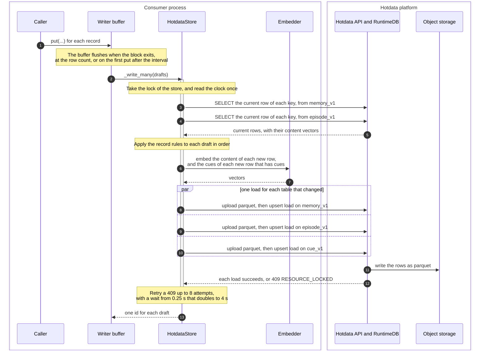

### The read

The read is one `SELECT` on each record table. It reads the rows whose `superseded_by` is
null, for every key in the batch at once. The read keeps the content vector of each row.
Thus a superseded row goes into the load with its old vector, and the embedder never sees
it again.

A read costs 0.3 to 0.6 seconds in the cloud. [measured] The read grows with the table.
In the benchmark, a write of one question took 0.29 s at p50 with one question in the
tables. With 19,864 rows in the tables, it took 1.91 s. [measured, local, 2026-10-10]

### The rules

The rules run in the process, on the rows that the read returned. For each draft, in order:

1. If the key holds episodes and the draft does not, or the reverse, the whole batch
   raises `ValueError` and writes nothing.
2. If the normalized content equals the current row, the draft writes nothing. If the
   draft brings a new source, it writes a new revision with the merged sources.
3. The new row gets the next revision and the time of the clock as `created_at`.
4. The current row gets `superseded_by`. With `close_previous`, it also gets
   `valid_until` and `expired_at`. A span that cannot close raises `ValueError`, and the
   batch writes nothing.

A later draft in the same batch sees the rows of the earlier drafts. Thus two puts of one
key in one flush write revisions n+1 and n+2.

### The loads

The new rows and the superseded rows of one table go into one parquet file and one upsert
load. The cue vectors of the new rows go into a second load, on `cue_v1`. The loads of one
batch run at the same time, one thread for each load. They are not atomic. If the cue load
fails, the record has no cue row. If the record load fails, a cue row is left without a
record, and the search drops it.

Each load uploads its file once, and then calls the load API. Only the load call is
retried on 409. A load of rows with no vector costs about 2.1 seconds in the cloud, and
the cost does not change with row count. [measured] With 1,536-dimension vectors, a load
of 100 rows took 2.5 s, and 1,000 rows 8.3 s. [measured, M4, 2026-10-21] So hotmemory buffers puts in a writer, and each flush pays for
one load for each table, not one load for each record.

If a load takes more than 10 seconds, the framework asks the API to run it as a job, and
then polls the job. [read from source, not observed] The engine then writes the rows to
object storage and records them in the catalog. The order of those two steps was not
observed.

hotmemory never sends `INSERT`, `UPDATE`, or `DELETE` in SQL. Every change to a row is a
keyed load. The cloud accepts `INSERT` and refuses `UPDATE` and `DELETE`. One row by
`INSERT` took 531 ms in the cloud, against 1,682 ms by load. [measured, M4, 2026-10-21]

## Remember and capture

`remember` writes facts that the caller already structured. `capture` asks an extractor
for the facts first. The extractor is a plain callable that the caller supplies. The
library ships no model and names no model.

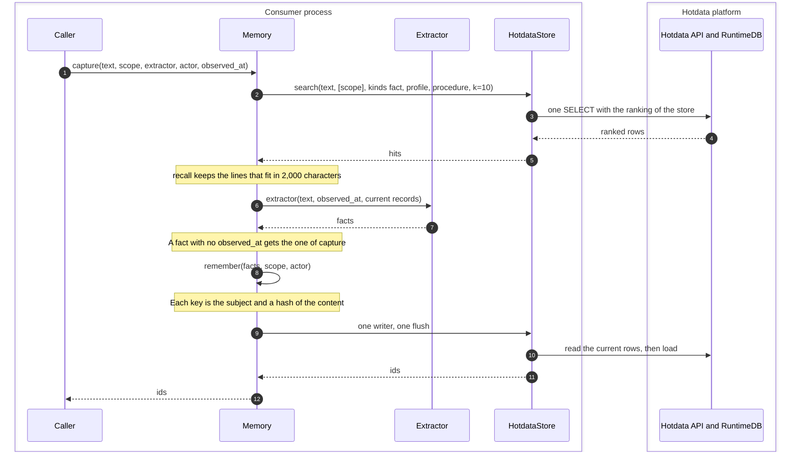

`remember` opens one writer whose row count is the number of facts. All the facts go into
one flush, so one refused fact means that no fact is written. The derived key makes a
retried call write nothing new.

The extractor sees the records that `recall` returns for the text, before the capture
writes anything. A write is never visible inside the same turn.

With an `episode` key, `capture` first reads the current revision of that key with `get`.
If it holds the same content, the call ends there, with no extractor call. Else the
diagram above runs with the id of the next episode revision added to the `sources` of
each fact, and then one `put` writes the text to `episode_v1`. The two writes are two
flushes, one for each table, in that order. A flush of `HotdataStore` loads its tables at
the same time, so with one writer for both, the episode can land without the facts. A retry
would then skip the extractor.

With `episode` and `chunk_chars`, `capture` cuts the text at blank lines into chunks, and
reads the current revision of each key `<episode>-<n>` with `get`. If every chunk holds the
same content, the call ends there. Else the extractor reads the whole text once, each fact
gets the id of every chunk in its `sources`, and one more flush writes the changed chunks
to `episode_v1`. The search of the extractor runs as above, so it uses the ranking of the
store, as `recall` does.

## Recall and search

`recall` calls `search` with the filter `kind` in (`fact`, `profile`, `procedure`). That
filter names no episode, so the search reads only `memory_v1`, and `cue_v1` with
`ranking="fused"`. The search
embeds the query once and sends one SQL query.

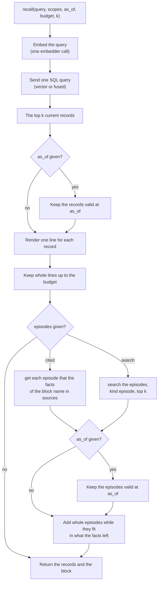

With `episodes="cited"`, `recall` sends one `get` for each distinct source that is a
valid record id in an allowed scope. Then it drops each record of another kind than
`episode`. With chunks, a fact cites every chunk of its session, so a fact that cites 11
chunks costs 11 `get` calls. With `episodes="search"`, it sends a second search with
the filter `kind` = `episode`, so that search reads `episode_v1`. With chunks, each chunk
is an episode, so that search ranks each chunk on its own. The episodes that `capture` and
`load` write have no cues, so the fused ranking of that search is BM25 and the content
vector.

The `as_of` filter runs in the process, after the search. It runs on the facts, and then
on the episodes. Thus `recall` with `as_of` can
return fewer than k records. The search keeps k records before the filter, so a record that
is valid at `as_of` but ranks below k is missing.

### The exact filters

Each ranking applies the same SQL condition, built from these parts:

- `superseded_by IS NULL`, so only current revisions match.
- `forget_after IS NULL OR forget_after > <now>`, so a record past its `forget_after`
  is hidden before `sweep` deletes it.
- One condition for each allowed scope, joined by `OR`. A scope matches a namespace that
  equals it, or that starts with it and `/`. Thus a match is on whole labels.
- The fields of the `Filter`: `kind IN (...)`, equality on `subject` and `actor`,
  `array_has_all(tags, ...)`, and a range on each time field that the filter sets.

### The fused ranking

`ranking="fused"` is an option. The default, `ranking="vector"`, ranks by the content
vector alone. With `ranking="fused"`, the search runs three rankings and fuses them by reciprocal rank
fusion. Reciprocal rank fusion adds `1 / (60 + rank)` from each ranking that holds a row.
Each ranking keeps its top rows to a depth of `max(100, 10 * k)`.

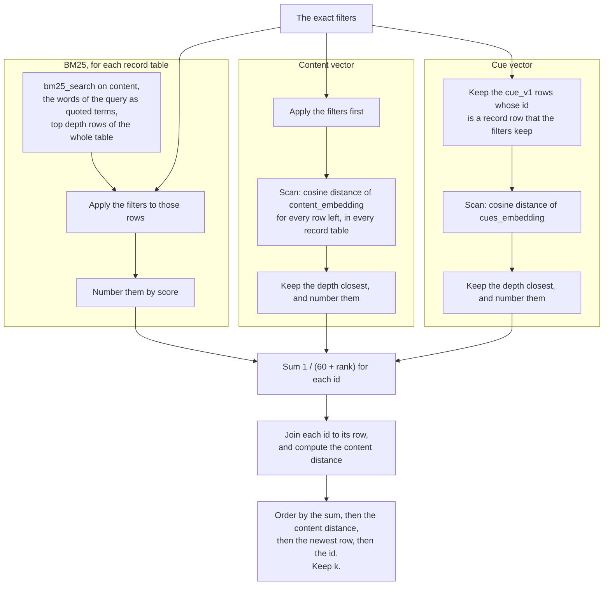

The two vector rankings filter first and then rank by a scan. They do not use the vector
index. A filtered search through a plain vector index returns only the rows that were in
the table at the build of the index. [measured, local, 2026-10-08] The query names its
table with an alias and names the distance, and that form makes the engine scan.
[measured, local, 2026-10-08]

BM25 needs its index. `bm25_search` refuses to run on a table without one. [measured] It
fetches its top rows from the whole table before the filters apply. So a narrow scope can
leave BM25 with fewer than k rows, while the vector rankings still rank every row in scope.

BM25 ranks each record table on its own, because the BM25 scores of two tables do not
compare. A fused search with an `episode` filter and another kind thus has four rankings.

Each `Hit` carries the content distance, also in the fused order. So a later hit can have a
smaller distance than an earlier one.

### The vector ranking

`ranking="vector"` sends a smaller query. It applies the exact filters, computes the
cosine distance of `content_embedding` for every row left, and keeps the k closest. Ties go
to the newest row, then to the id. This is the order of `MemoryStore`, and the oracle test
compares the two. A store is built with one ranking. The benchmark runner builds two stores
over one database, one for each ranking.

### What a search costs

| Where | Fused, p50 | Vector, p50 | Rows in scope |
|---|---|---|---|
| Local stack | 130 ms | 42 ms | about 50 |
| Cloud | 998 ms | 361 ms | about 50 |

These are the LongMemEval-S numbers of [benchmarks.md](../benchmarks.md), measured on
2026-10-10. In the cloud, one request costs about 400 ms at every table size up to 100,000
rows. [measured 2026-10-05]

## Supersede

`supersede` closes one record and writes the next revision under its key. It reads the
key with `get`, and then sends one `put` with `close_previous`. The put is a write like any
other: a read, and a load on `memory_v1`. If the fact has cues, it also sends a load on
`cue_v1`.

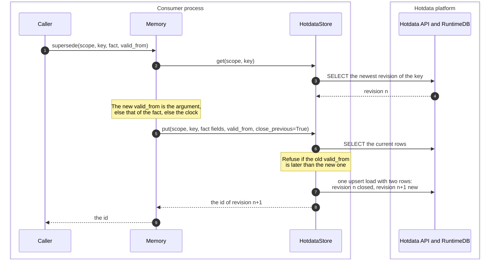

Both rows go into one parquet file and one load.

| Row | `valid_from` | `valid_until` | `expired_at` | `superseded_by` |
|---|---|---|---|---|
| Revision n, before | T0 | null | null | null |
| Revision n, after | T0 | T1 | the clock at the write | revision n+1 |
| Revision n+1 | T1 | null | null | null |

`valid_until` is on the world clock: when the fact stopped being true. `expired_at` is on
the system clock: when the store learned it. A put without `close_previous` sets only
`superseded_by`, and the span of revision n stays open.

## Forget and sweep

A record can leave memory in three ways.

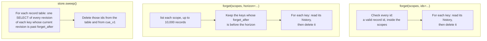

A `delete` of one key reads the ids of its rows from each record table. Then it sends a
keyed delete load to that table and one to `cue_v1`, at the same time. A key lives in one
record table only, so a `delete` sends two loads.

A record past its `forget_after` is hidden at once, because the exact filters leave it out.
Its rows stay in the table until `sweep` runs. `list` does not return such a record, so
`forget` with a horizon cannot find it, and `sweep` deletes it. The `expires_at` field of a
database is a record only, and the platform deletes nothing. [measured]

After a keyed delete load, neither a provider-backed vector index nor a BM25 index
returned the deleted row. [measured, M2] A plain vector index was not part of that
measurement, and the vector rankings do not read it.

## Load

`load` turns one Markdown document into episodes and facts. It cuts the document into
chunks first, with no call to the platform. [contracts.md](../contracts.md) gives the four
steps of the cut.

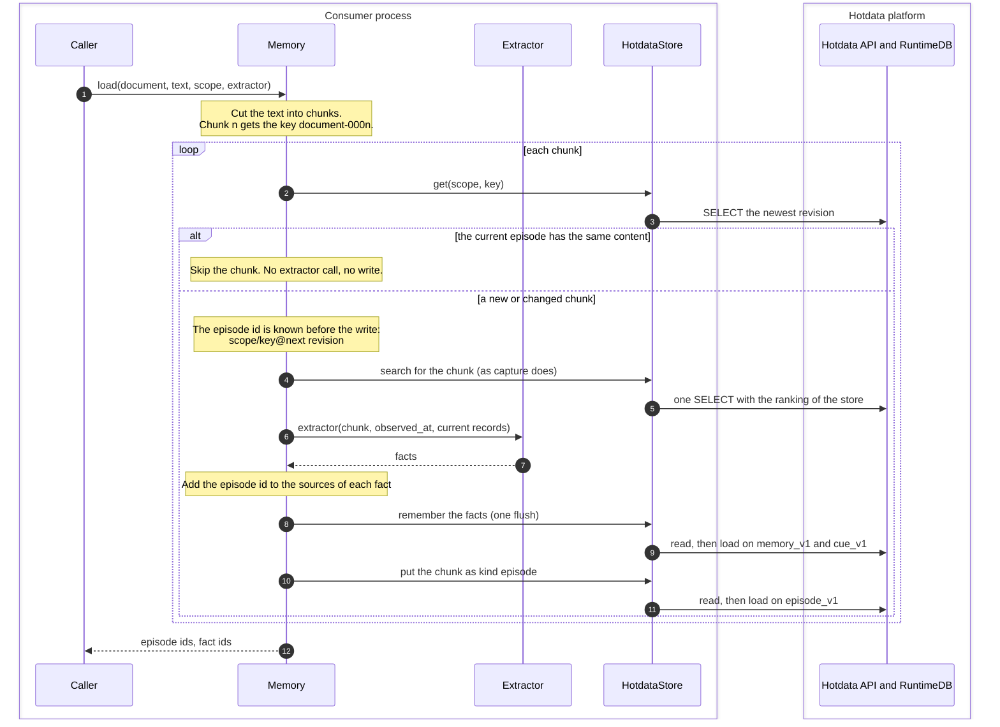

The facts of a chunk are written before its episode. If the episode write fails, the facts
name an episode that does not exist yet. The next `load` of the same text finds no current
episode for that chunk, so it calls the extractor again and writes the episode. The facts
that the extractor returns again have the same keys, so they write nothing new, unless they
bring a new source.

A new or changed chunk sends six SQL queries: one for `get`, one for the search, and two
for each of the two writes. It sends up to three loads, on `memory_v1`, `cue_v1`, and
`episode_v1`. Only facts with cues need the load on `cue_v1`. In the cloud, a load costs about
2.1 seconds. [measured] A load of many chunks is thus slow in the cloud, and the cost
comes from the number of chunks, not from their size. The cost of a
whole document load was not measured in hotmemory.

A consumer reads the episode of a fact with `get`, from an id in `sources`. In SQL, a
consumer can join `memory_v1` to `episode_v1` on those ids.

## The as-of rule

Two conditions make a record valid at time T. `valid_from` is null or at most T.
`valid_until` is null or after T. A null `valid_from` means the start of time.

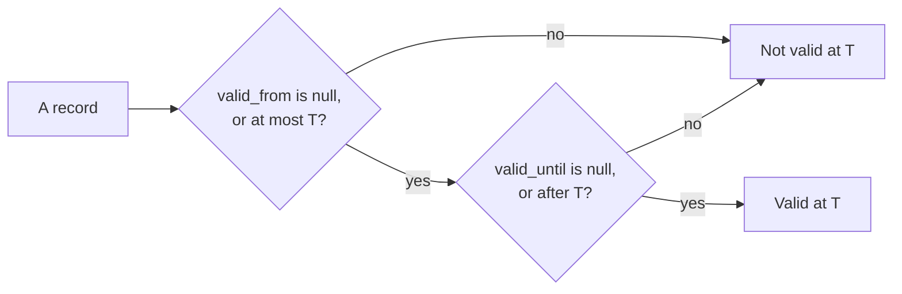

`recall` applies the rule in the process, to the current revisions that the search
returned. It never reads a superseded revision. A fact can be valid at T and still be
missing, because a later revision replaced it after T. A search over history does not exist
yet.

If the caller sets no `valid_from`, a `put` gives it the value of `observed_at`. If a fact
has no `observed_at`, `capture` and `load` give it the `observed_at` of the call. So a fact from
a document loaded with an old `observed_at` is valid from that time, and `recall` with an
earlier `as_of` leaves it out.

## Not observed

These claims on this page come from reading source, or were not measured:

- The CDN and the gateway in front of the cloud engine.
- The upload steps of the SDK, and the load job that the framework asks for.
- The order in which the engine writes parquet files and records them in the catalog.
- Whether each load writes exactly one parquet file.
- Where the cloud keeps the catalog, the parquet files, and the index files.
- Whether the sorted index on `created_at` serves `list` and `sweep`.
- The cost of a whole document `load` in the cloud.
- `provision` in a workspace with more than 100 databases. An offline test proves the
  paging against a fake listing.
